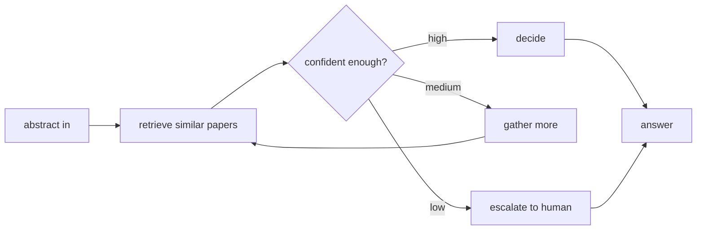
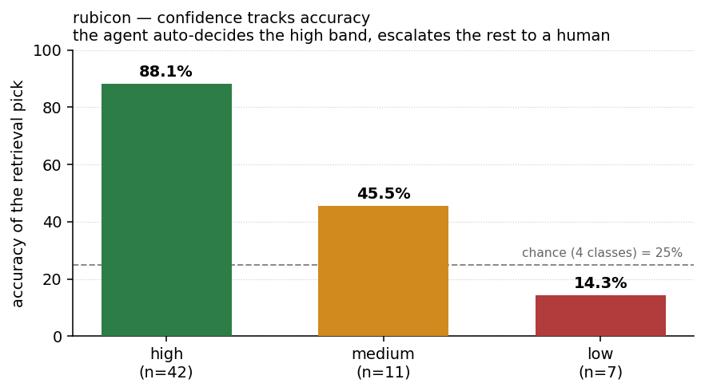

# rubicon


[](https://github.com/langchain-ai/langgraph)
-b31b1b.svg)

**A small agent that decides its own steps and escalates to a human when it isn't sure.**

Most pipelines are assembly lines: the programmer fixes the order of steps. rubicon
replaces that with an agent — it is handed a task and a set of tools, and it decides
which tool to use when, checks its own confidence, and asks a human when a case is
too uncertain to call on its own.

Every number in this README is measured, and the counter-story is written down too:
the section below shows where adding a local LLM made the result *worse*, not better.

> Built by Tekin Ertekin with Claude Code.

---

## What this is

A compact, self-contained project built to work through agent frameworks (LangGraph)
hands-on, with a real task and real data rather than a toy. The task: classify an
arXiv paper into its subject area from the abstract alone. The twist is that the agent
is not a fixed script — it looks up similar papers, judges how confident it is, and
then chooses what to do next: commit the answer, gather more evidence, or hand the
case to a human. The design question it answers is not "can a model label a paper"
(easy) but "does the system know when *not* to answer on its own" — the part most
agent demos skip.

## How it works



The order of those steps is the agent's to choose, not hard-coded. A plain pipeline
runs each step once, in a fixed order; rubicon loops — gathering more evidence and
re-checking — until it is confident enough to commit or decides a human should look.

The confidence-and-escalation layer is the real point. Picking the most likely label
is easy; measuring how trustworthy that pick is, and routing the shaky ones to a
person instead of guessing, is what makes the output usable.

## Layout

```
rubicon/agent.py        the decision loop (LangGraph state graph)
rubicon/tools.py        the tools the agent may call
rubicon/calibration.py  confidence banding + human-escalation rule
examples/run_demo.py    end-to-end run on real, public data
data/                   dataset (not committed; see examples)
```

## Status

Early / learning project. Not on PyPI yet — will publish only if a genuinely
reusable piece emerges (likely the calibration + escalation layer).

## Data

Real, public data from the **arXiv API** — no key, no synthetic examples. The demo
pulls recent papers from four categories (cs.LG, cs.CL, cs.CV, math.NA), indexes
most of them, holds the rest out, and asks the agent to classify each held-out
abstract by subject.

```
python -m examples.run_demo            # fetch live from arXiv
python -m examples.run_demo --cached   # reuse data/papers.jsonl
```

## Result (60 held-out papers)

```
band      n    accuracy
high     42     88.1%        <- decided by the agent on its own
medium   11     45.5%
low       7     14.3%

auto-decided (no human):  42   acc 88.1%
escalated to human:       18   ( 30.0% of all)
overall if forced:        60   acc 71.7%
```



Confidence tracks accuracy (88 → 45 → 14), so escalating the uncertain 30% lifts
auto-decision accuracy from 71.7% (if forced to guess) to 88.1%. The agent knows
when it does not know.

## Does a local LLM help? Measured — no.

The decision step is pluggable (`rubicon/llm.py`, a local Ollama model). Wiring
`qwen2.5:7b` to override the retrieval pick on the confident cases **lowered**
auto-decision accuracy:

```
                          auto-decided accuracy   escalated
retrieval + calibration          88.1%              30%
qwen2.5:7b decides               76.2%              30%
```

On this task a 7B local model does not beat a well-built retrieval + calibration
baseline — it loses 12 points on the cases that matter. So the default decision
stays with retrieval; the LLM hook is kept as an opt-in for comparison, not the
default path. Measuring this was the point.

A note on the thresholds and the result. With four classes, chance is 25%; I set the
bands (auto ≥ 0.60, escalate < 0.40) so the auto band stays reliably above ~85% and
everything shakier goes to a human — the low band here sits *below* chance, which is
exactly the kind of case you never want a system to answer on its own. As for the 7B
model losing: on the confident cases retrieval is already right ~88% of the time, so
asking a small model to re-pick mostly gives it the chance to overturn correct answers,
and it takes it — it adds noise, not signal, where the baseline is already strong. The
place a model could actually earn its keep is the medium band (retrieval ~45%), not the
high one; wiring the LLM to fire only there is the next thing to measure. I'd rather
report that the local model lost than pretend it helped.
